<div align="center">

# Provenance Risk

### Supplier and counterparty risk intelligence, with every score traceable to its evidence

[](https://github.com/Naureen39/BELA-supplier-risk-intelligence/actions/workflows/ci.yml)


</div>

> **Status: a complete build on synthetic data, not a production service.** The matching pipeline, API, web application,
> monitoring, reports, and revenue analytics are built and tested. The demo uses fictional companies and generated events.
> The neural linkers (BELA, BLINK) and the local language model are integrated through interfaces but have not been trained
> or run, so the demo resolves suppliers with retrieval and probabilistic scoring only. There is no gold evaluation set, and
> published precision figures are labeled synthetic. See [Project status and limitations](#project-status-and-limitations).

---

## Table of contents

1. [Overview](#overview)
2. [Objectives](#objectives)
3. [What we build](#what-we-build)
4. [How it helps](#how-it-helps)
5. [Architecture](#architecture)
6. [Technology stack](#technology-stack)
7. [Getting started](#getting-started)
8. [Repository structure](#repository-structure)
9. [Documentation](#documentation)
10. [Testing and quality](#testing-and-quality)
11. [Security and privacy](#security-and-privacy)
12. [Project status and limitations](#project-status-and-limitations)
13. [License and data terms](#license-and-data-terms)

---

## Overview

Public records about companies are scattered across many regulators and news outlets, and they name companies
inconsistently: "Northgate Metals Corp.", "NORTHGATE METALS CORPORATION", and a plant listed under a subsidiary can all be
the same supplier. A procurement or risk team that wants to know whether a supplier has a safety violation, a recall, or an
environmental enforcement action has to do that matching by hand.

**Provenance Risk** automates the matching and keeps a person in charge of every uncertain decision. It links regulator
records and news to the companies in a supplier list, follows ownership from the facility up to the parent company and
across to its subsidiaries, and turns the linked records into an explainable risk score with alerts. Every score shows the
events behind it, the public record each event came from, and the evidence for each link.

> Risk signals are leads for human review and not statements of fault. The absence of a record is not evidence of good
> practice.

## Objectives

| # | Objective | How it is met |
|---|---|---|
| 1 | **Resolve messy names to the right company** | Normalization, identifier matching, trigram and vector retrieval, a Fellegi-Sunter pair model with calibration, and versioned routing thresholds |
| 2 | **Never act on an uncertain match silently** | Three routes (`accepted`, `review`, `nil`); uncertain cases go to a review queue; degraded results can never be accepted automatically |
| 3 | **Follow ownership, not just names** | A corporate graph connects facilities, subsidiaries, parents, and siblings, so an event at a plant reaches the suppliers it affects |
| 4 | **Make every score explainable** | Each score lists its components (severity, recency, link confidence, relationship weight, source reliability) with links to the source records |
| 5 | **Keep tenants strictly separate** | PostgreSQL row level security enforced per request, role-based access, hashed and scoped API keys, mandatory MFA for administrators |
| 6 | **Be honest about what is measured** | Every figure states its data, synthetic results are labeled, and unmeasured components are documented as such |
| 7 | **Be operable** | Health checks, retries with a dead letter queue, retention enforcement, a tested backup and restore, and a container stack |

## What we build

| Component | Description |
|---|---|
| **Knowledge base** | A canonical company table with aliases, identifiers (CIK, LEI, Wikidata), headquarters, facilities, and ownership edges that carry their source and date |
| **Resolution engine** | Links a supplier name, a regulator record, or a news mention to a canonical company, with candidates, scores, route, and model versions stored for audit |
| **Event pipeline** | Turns regulator records and news into typed, severity-banded events linked to companies |
| **Risk scoring and alerts** | Combines the events that reach a supplier into one score, raises alerts from configurable rules, and delivers them live, by webhook, and by email |
| **REST API** | FastAPI service with cookie sessions for the application and scoped API keys for integrations |
| **Product application** | Supplier lists and profiles, review queue, alerts, corporate-family explorer, analytics, PDF reports, and administration |
| **Marketing website** | Product, solutions, industries, methodology, pricing, and legal pages, with accessibility and cross-browser tests |
| **Revenue analytics** | Platform-level MRR, retention, cohorts, forecast, and billing health over synthetic subscription data |
| **Operations kit** | Compose stack with TLS, demo seed, backup drill, load tests, retention job, and runbook |

## How it helps

| Audience | Value |
|---|---|
| **Procurement and supply chain** | Upload a supplier list once and see which suppliers, or their parents and subsidiaries, have recent safety, environmental, or recall events, ranked by score |
| **Third-party risk and compliance** | An audit trail for every match and every decision, hash-chained, with evidence and model versions recorded |
| **Analysts** | A review queue that shows the uploaded record beside ranked candidates, field by field, so decisions take seconds and are consistent |
| **Engineering teams** | A documented API with examples, scoped keys, idempotent uploads, and predictable error behavior |
| **Leadership** | Concentration views and portfolio trends instead of a spreadsheet of disconnected records |

## Architecture

The diagram shows the workflow end to end: public sources are normalized and linked to a canonical company graph, linked
events are scored against each tenant's suppliers, and the results reach people through the application, reports, alerts,
and the API.

```mermaid
flowchart LR
    %% ---------- styling ----------
    classDef src fill:#FFF4E0,stroke:#C77700,stroke-width:2px,color:#3D2A00
    classDef ingest fill:#E6EFFB,stroke:#1F5FBF,stroke-width:2px,color:#0B1B33
    classDef engine fill:#E3F6F4,stroke:#00A3A3,stroke-width:2px,color:#06302F
    classDef model fill:#F0E9FB,stroke:#8E5BD9,stroke-width:2px,color:#2B1A4D,stroke-dasharray:5 3
    classDef store fill:#E8F5EC,stroke:#1E8E5A,stroke-width:2px,color:#0B2E1D
    classDef svc fill:#12305A,stroke:#0B1B33,stroke-width:2px,color:#FFFFFF
    classDef edge fill:#0B1B33,stroke:#0B1B33,stroke-width:2px,color:#FFFFFF
    classDef out fill:#FDECEC,stroke:#C0392B,stroke-width:2px,color:#4A1510
    classDef human fill:#FFFFFF,stroke:#12305A,stroke-width:3px,color:#0B1B33

    %% ---------- 1. sources ----------
    subgraph S["<b>1. PUBLIC SOURCES</b>"]
        direction TB
        S1["<b>Regulators</b><br/>EPA ECHO, OSHA, NHTSA,<br/>CPSC, openFDA"]:::src
        S2["<b>Ownership</b><br/>SEC EDGAR, GLEIF,<br/>Wikidata"]:::src
        S3["<b>News discovery</b><br/>GDELT metadata"]:::src
        S4["<b>Customer input</b><br/>Supplier list<br/>CSV upload or API"]:::src
    end

    %% ---------- 2. ingestion ----------
    subgraph I["<b>2. INGEST AND NORMALIZE</b>"]
        direction TB
        I1["<b>Downloaders</b><br/>checksummed, resumable,<br/>terms recorded"]:::ingest
        I2["<b>Normalizer</b><br/>names, legal suffixes,<br/>addresses, identifiers"]:::ingest
        I3["<b>Upload validation</b><br/>limits, formula-injection<br/>guard, column mapping"]:::ingest
    end

    %% ---------- 3. resolution ----------
    subgraph R["<b>3. RESOLUTION ENGINE</b>"]
        direction TB
        R1["<b>Candidate retrieval</b><br/>trigram + vector search<br/>pg_trgm, pgvector"]:::engine
        R2["<b>Pair scoring</b><br/>Fellegi-Sunter model,<br/>logistic combiner, calibration"]:::engine
        R3{"<b>Route</b><br/>versioned thresholds"}:::engine
        M1["<b>Optional neural linkers</b><br/>BELA, BLINK, local LLM<br/>reduced confidence if absent"]:::model
    end

    %% ---------- 4. knowledge + events ----------
    subgraph K["<b>4. KNOWLEDGE AND EVENTS</b>"]
        direction TB
        K1[("<b>Canonical companies</b><br/>aliases, identifiers,<br/>facilities")]:::store
        K2[("<b>Ownership graph</b><br/>parents, subsidiaries,<br/>siblings, sources")]:::store
        K3["<b>Event builder</b><br/>type, severity band,<br/>evidence snippet, source URL"]:::engine
    end

    %% ---------- 5. scoring ----------
    subgraph C["<b>5. SCORING AND ALERTING</b>"]
        direction TB
        C1["<b>Reach analysis</b><br/>events that reach a supplier<br/>through ownership"]:::engine
        C2["<b>Risk score</b><br/>severity x recency x link confidence<br/>x relationship x source reliability"]:::engine
        C3["<b>Alert rules</b><br/>live, webhook, email,<br/>retry + dead letter queue"]:::engine
    end

    %% ---------- 6. platform ----------
    subgraph P["<b>6. PLATFORM SERVICES</b>"]
        direction TB
        P1["<b>Caddy</b><br/>TLS, compression"]:::edge
        P2["<b>FastAPI</b><br/>auth, RBAC, rate limits,<br/>audit log"]:::svc
        P3[("<b>PostgreSQL 17</b><br/>row level security<br/>per tenant")]:::store
        P4[("<b>Valkey</b><br/>cache, limits,<br/>live fan-out")]:::store
    end

    %% ---------- 7. experience ----------
    subgraph U["<b>7. EXPERIENCE AND DELIVERY</b>"]
        direction TB
        U1["<b>Web application</b><br/>suppliers, explorer,<br/>analytics, administration"]:::out
        U2["<b>Review queue</b><br/>human decision on<br/>uncertain matches"]:::human
        U3["<b>Reports and alerts</b><br/>PDF, SSE, webhooks,<br/>email"]:::out
        U4["<b>Integrations</b><br/>scoped API keys,<br/>curl, Python, JavaScript"]:::out
    end

    %% ---------- flow ----------
    S1 --> I1
    S2 --> I1
    S3 --> I1
    S4 --> I3
    I1 --> I2
    I3 --> I2
    I2 --> R1
    R1 --> R2
    M1 -.->|"extra evidence"| R2
    R2 --> R3
    R3 -->|"accepted"| K1
    R3 -->|"review"| U2
    R3 -->|"nil"| U2
    U2 -->|"decision<br/>stored with evidence"| K1
    K1 --- K2
    K1 --> K3
    K2 --> C1
    K3 --> C1
    C1 --> C2
    C2 --> C3
    C2 --> P3
    C3 --> U3
    P1 --> P2
    P2 <--> P3
    P2 <--> P4
    P2 --> U1
    P2 --> U4
    P3 --> U3
    U1 --> U2
```



**Reading the diagram**

- **Solid arrows** are the main data path. The **dashed arrow** is optional evidence: when the neural linkers are down or
  absent, resolution continues with retrieval and probabilistic scoring and flags the result *reduced confidence*, which can
  never be accepted automatically.
- **Three routes:** `accepted` links are stored with their score and model versions; `review` and `nil` outcomes go to a
  person, whose decision is stored with the same evidence.
- **Tenancy:** every request runs under PostgreSQL row level security, so isolation holds even if a query forgets a
  condition. System jobs use the owner connection.
- **Failure behavior:** uploads, webhooks, and email are retried with backoff and then kept in a dead letter queue; a
  database outage answers `503` with `Retry-After`.

Full detail: [docs/architecture.md](docs/architecture.md).

## Technology stack

| Layer | Technologies |
|---|---|
| **Backend** | Python, FastAPI, psycopg 3 with connection pooling, Alembic (SQL migrations), Pydantic |
| **Data and search** | PostgreSQL 17, pgvector, pg_trgm, pgcrypto, materialized views, Valkey |
| **Matching and modeling** | rapidfuzz, Fellegi-Sunter scoring, isotonic calibration, statsmodels (forecast); BELA and BLINK through service interfaces |
| **Security** | Argon2id, EdDSA tokens in httpOnly cookies, CSRF double submit, TOTP MFA, hash-chained audit log, row level security |
| **Frontend** | Next.js 16, React 19, Tailwind CSS 4, TanStack Query and Table, ECharts, Cytoscape, Radix UI |
| **Reports** | WeasyPrint (PDF) |
| **Quality** | pytest, ruff, mypy (strict), Vitest, Playwright (Chrome, Firefox, WebKit) with axe-core, Lighthouse, Locust |
| **Security scanning** | Bandit, pip-audit, npm audit gate, Trivy, gitleaks |
| **Packaging** | Docker Compose, Caddy (TLS), GitHub Actions |

## Getting started

### Run the demo

Requires Docker with the compose plugin (v2.23 or newer), `openssl`, and `make`. About 3 GB of disk for the images.

```bash
git clone https://github.com/Naureen39/BELA-supplier-risk-intelligence.git
cd BELA-supplier-risk-intelligence
make demo
```

`make demo` writes a `.env` with fresh random secrets, builds the images, starts PostgreSQL, Valkey, the API, the web
application, and Caddy, runs the migrations, seeds the demo, and **prints the six account passwords once**. Then open
<https://localhost> (accept Caddy's local certificate, or run `docker compose exec caddy caddy trust`). Password reset and
invitation emails appear in Mailpit at <http://localhost:8025>.

| Account | Role | Access |
|---|---|---|
| `viewer@demo.example` | Viewer | Read-only; the role for a public demo |
| `analyst@demo.example` | Analyst | Upload, review matches, act on alerts |
| `manager@demo.example` | Manager | Also alert rules, analytics, reports |
| `admin@demo.example` | Tenant admin | Users, API keys, risk settings, audit log (MFA setup at first sign-in) |
| `finance@demo.example` | Finance analyst | Revenue and billing analytics |
| `platform@demo.example` | Platform admin | Tenants and the platform review queue (MFA setup at first sign-in) |

Passwords are generated per install and stored only as Argon2id hashes. Lost them? `make demo-reset` wipes the demo
database and seeds again. Stop with `make demo-down`. A guided tour is in [docs/walkthrough.md](docs/walkthrough.md).

> **Not yet measured:** the container files were written on a machine without Docker, so the full `make demo` run and its
> duration have not been observed. Every step was run separately without containers, and the CI `packaging` job builds and
> starts the stack. See [docs/deploy.md](docs/deploy.md).

### Run without Docker (development)

Requires Python 3.11 or newer, Node 22 or newer, PostgreSQL 16 or newer with `pgvector`, `pgcrypto`, and `pg_trgm`, and
optionally Valkey or Redis.

```bash
make setup && make web-install
createdb provenance
export DATABASE_URL=postgresql://localhost/provenance COOKIE_SECURE=false \
       ALLOW_EPHEMERAL_SECRETS=true PYTHONPATH=apps/api:.
make migrate
.venv/bin/python infra/demo/seed_demo.py --database-url $DATABASE_URL   # prints the passwords once
make api        # http://127.0.0.1:8000/api/docs
make web-dev    # http://127.0.0.1:3000
```

To also run the supplier upload through the real pipeline, start the API first and add
`--api-url http://127.0.0.1:8000 --web-url http://127.0.0.1:3000` to the seed command on an unseeded database.

### Call the API

```bash
curl -s -X POST -H "Authorization: Bearer $KEY" -H "Content-Type: application/json" \
     -d '{"name": "Crescent Pharma Holdings"}' https://localhost/api/v1/resolve
```

More examples in curl, Python, and JavaScript: [docs/api_guide.md](docs/api_guide.md).

## Repository structure

| Path | Contents |
|---|---|
| `apps/api` | FastAPI service, Alembic migrations, resolution engine, event pipeline, alerts, reports, analytics |
| `apps/web` | Next.js marketing site and product application; Playwright and Vitest tests |
| `services` | Optional model services: BELA mention linker, BLINK re-ranker, language model runner |
| `data` | Source downloaders, the source registry (`manifest.yaml`), demo data generators |
| `training` | Training data and model fitting |
| `infra` | Container files, Caddy configuration, demo seed, backup drill, load tests, cron entries, license report |
| `docs` | Documentation, evaluation outputs, screenshots |
| `compose.yaml` | The production-style stack |

## Documentation

| Document | For |
|---|---|
| [Architecture](docs/architecture.md) | How the pieces fit together |
| [API guide](docs/api_guide.md) and [API design](docs/api.md) | Calling the API; authentication and security design |
| [Data guide](docs/data_guide.md) | Sources, what is loaded, how to rebuild |
| [Model card](docs/model_card.md) and [evaluation report](docs/eval/report.md) | Models, training data, evaluation method and results |
| [Runbook](docs/runbook.md) and [deployment](docs/deploy.md) | Operating, backing up, restoring, deploying |
| [Security review](docs/security_review.md) | Review against the security specification |
| [Licensing](docs/licensing.md) | Data, model, font, and dependency licenses |
| [Performance](docs/perf.md) and [quality review](docs/quality_review.md) | Measurements and findings |
| [Walkthrough](docs/walkthrough.md) | Product tour script |

## Testing and quality

```bash
make test        # backend (set TEST_DATABASE_ADMIN_URL for the database tests)
make lint        # ruff, mypy --strict, project style checks
make web-check   # prettier, eslint, tsc, vitest
make screenshots # capture docs/screenshots from a running site
```

| Check | Last measured result |
|---|---|
| Backend tests | 260 passed, 92% coverage of the application package |
| Static analysis | ruff and `mypy --strict` clean |
| Web unit tests | 22 passed |
| End-to-end (Chrome) | Full suite of 237 tests in the previous phase; Firefox and WebKit run the read-only specs |
| Accessibility | axe-core: 0 violations on marketing and application pages checked; Lighthouse accessibility 100 on five pages |
| Load (one machine, synthetic data) | 50 concurrent users: p50 7 ms, p95 11 ms; see [docs/perf.md](docs/perf.md) for method and limits |

End-to-end browser test instructions: [docs/app.md](docs/app.md).

## Security and privacy

- **Authentication:** Argon2id passwords with strength checks, TOTP MFA (mandatory for administrators), rotating refresh
  tokens with reuse detection, hashed and scoped API keys.
- **Isolation:** PostgreSQL row level security per request, with cross-tenant tests through both the API and SQL.
- **Integrity:** append-only, hash-chained audit log with verification.
- **Data handling:** article text is stored as snippets of at most 300 characters; tenant identifiers are encrypted;
  retention is enforced by a purge job; customer lists are not used for training without a setting.
- **Hardening:** content security policy, HSTS, CSRF protection, upload limits and spreadsheet formula neutralization,
  non-root read-only containers in the compose stack.

Scanner results, the requirement-by-requirement table, and the known gaps are in
[docs/security_review.md](docs/security_review.md). This is a code and configuration review, not a penetration test.

## Project status and limitations

**Verified** by automated tests or measurements in this repository: authentication, authorization, and tenant isolation;
matching, scoring, alerting, and reporting logic; the web application in Chrome, Firefox, and WebKit; accessibility checks
with axe; API load on one machine; backup and restore of a database.

**Not verified or not done:**

- The neural linkers (BELA, BLINK) and the language model are not trained or run; their accuracy and throughput are unknown.
- There is no gold evaluation set; published precision figures come from a synthetic split and are labeled as such.
- The container images and the full `make demo` run have not been executed locally (no Docker on the build machine); CI
  builds them.
- No penetration test, ZAP baseline, screen reader audit, or real-device browser testing.
- Python dependencies are pinned only at the top level; webhooks are unsigned; the content security policy keeps
  `'unsafe-inline'` for framework scripts.
- Structured regulator coverage is mostly the United States; a quiet profile outside the United States should not be read
  as a clean one.

## License and data terms

No code license has been chosen yet, so all rights are reserved by the author until a license file is added. Data,
model, font, and dependency terms that constrain redistribution are recorded in [docs/licensing.md](docs/licensing.md).
This project builds on the open-source BELA and BLINK releases and is not affiliated with their authors.
